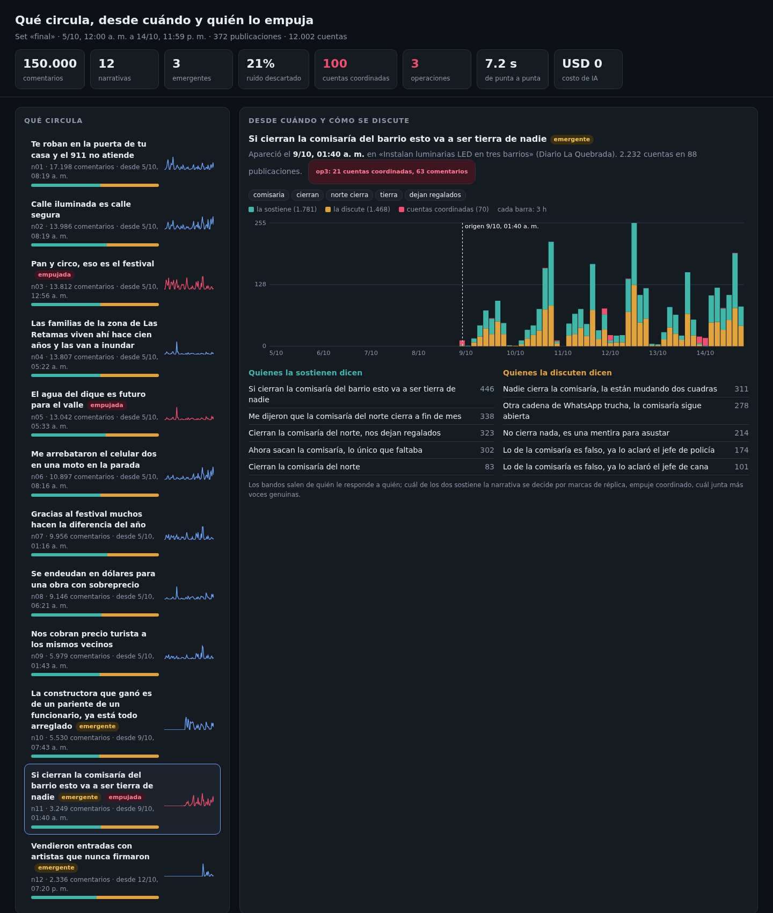

# Qué circula, desde cuándo y quién lo empuja

Solución al [Desafío QualyData](DESAFIO.md) (Hackathon Argentina Space 2026): un pipeline que lee los comentarios crudos y devuelve las narrativas en discusión, la postura de cada comentario, cuándo apareció cada narrativa y qué cuentas actúan en bloque.

No usa IA generativa ni embeddings: procesa el set final (150.000 comentarios) en unos 7 segundos en una CPU, con costo de IA de USD 0.



## Correrlo

```bash
python -m venv .venv && source .venv/bin/activate     # Windows: .venv\Scripts\activate
pip install -r requirements.txt

# set final (assets del release `set-final`, descomprimidos en datos/final/)
python correr.py --datos datos/final --salida entrega

# set de práctica, con el evaluador oficial al final
python correr.py --datos datos/practica --salida salida/practica --puntuar
```

Un comando hace todo: ingesta, análisis, los cuatro archivos de `entrega/`, el panel (`panel/<set>.html`) y la base consultable (`salida/almacen/<set>/qualy.duckdb`). El resultado es determinista: dos corridas dan archivos idénticos byte a byte (lo verifica un test).

El panel es un único HTML sin dependencias: se abre con doble clic. [`panel/final.html`](panel/final.html) ya está generado sobre el set final.

Pruebas: `python -m unittest` (normalización, bipartición, corrida de punta a punta con datos sucios, puntaje mínimo en práctica y determinismo).

## Resultados

| Set | Comentarios | Narrativas | Ruido | Cuentas coordinadas | Tiempo | Puntaje automático |
|---|---|---|---|---|---|---|
| Práctica | 200.000 | 13 | 37.710 | 115 en 3 operaciones | 10 s | **55,0 / 55** |
| Final | 150.000 | 12 | 31.062 | 100 en 3 operaciones | 7 s | sin verdad pública |

El set de práctica es el que usamos para desarrollar, así que su puntaje es una cota optimista. El set final se procesó con el mismo código y los mismos parámetros, sin mirar etiquetas (no las hay) ni tocar la entrega a mano.

En el set final aparecen tres operaciones:

- **op1, 51 cuentas**, 50 de ellas creadas en los días previos al período, empujan «El agua del dique es futuro para el valle» con textos casi idénticos y el hashtag #DiqueSí.
- **op2, 28 cuentas** antiguas y con textos variados, empujan «Pan y circo, eso es el festival». No repiten texto: se delatan porque llegan juntas a las mismas publicaciones 15 veces y se responden entre ellas.
- **op3, 21 cuentas** creadas durante el período, de madrugada, instalan el rumor del cierre de la comisaría. El primer comentario de esa narrativa es de ellas.

## Cómo funciona

1. **Almacén** ([`qualy/almacen.py`](qualy/almacen.py)). DuckDB lee los CSV, descarta filas sin id, sin fecha válida o duplicadas, y guarda Parquet comprimido.
2. **Formas canónicas** ([`qualy/texto.py`](qualy/texto.py)). Cada comentario se reduce a su forma: sin mayúsculas, tildes, emojis ni letras repetidas; con los typos corregidos hacia la palabra frecuente a distancia de edición 1; y sin las muletillas de apertura y cierre («la verdad», «posta», «ojo»). Las muletillas no vienen de una lista: se aprenden de los datos, como prefijos y sufijos que aparecen alrededor de muchos textos distintos. 150.000 comentarios quedan en unas 500 formas.
3. **Narrativas y ruido** ([`qualy/narrativas.py`](qualy/narrativas.py)). Se arma un grafo donde dos formas quedan unidas cuando una le responde a la otra de manera repetida. Cada componente conexa es una narrativa; no hay que fijar cuántas son. Lo que nunca entra en una discusión es ruido. Las respuestas cortas («Tal cual», «Exacto») se detectan porque casi siempre aparecen como respuesta, y heredan narrativa y postura del comentario al que responden.
4. **Postura**. Una respuesta con contenido contradice a su padre, así que cada narrativa se parte en dos bandos (bipartición con union-find de paridad). Falta decidir cuál bando afirma y cuál desmiente; se combinan cuatro evidencias: marcas de réplica («dejen de», «es falso», «lo de…»), variedad de redacciones, de qué lado empujan las cuentas coordinadas y qué bando junta más voces genuinas.
5. **Origen**. El primer comentario de la narrativa, con su publicación.
6. **Coordinación** ([`qualy/coordinacion.py`](qualy/coordinacion.py)). Para cada par de cuentas se cuenta en cuántas publicaciones distintas coincidieron del mismo lado de la misma narrativa en menos de 30 minutos, normalizado por la actividad de ambas. Coincidir una vez es viralidad; coincidir muchas veces con las mismas cuentas no. Sobre esos vínculos se extrae el núcleo denso (k-core), se exige que el grupo haya actuado en bloque al menos tres veces y se suman las cuentas que usan los textos exclusivos del grupo. No depende de texto idéntico ni de la edad de la cuenta, por eso encuentra también a la operación de cuentas viejas con textos variados.

## Almacenamiento

DuckDB sobre Parquet. No hay servidor que levantar, los comentarios del set final ocupan 2,5 MB en Parquet (3,4 MB en CSV con gzip) y los resultados quedan consultables con SQL:

```bash
python -c "import duckdb; print(duckdb.connect('salida/almacen/final/qualy.duckdb').sql('select narrativa, titulo, comentarios, comentarios_coordinados from resultado_narrativas order by comentarios desc'))"
```

Tablas: `comentarios`, `cuentas`, `publicaciones`, `fuentes` (limpias) y `resultado_comentarios`, `resultado_narrativas`, `resultado_cuentas`, `resultado_vinculos`, `resultado_eventos`.

## Costo y escala

Medido: 150.000 comentarios en 7 s y 200.000 en 10 s en un solo proceso (unos 20.000 comentarios por segundo), sin GPU y sin llamadas a servicios externos. El detalle está en [`entrega/costo.json`](entrega/costo.json).

Lo que no medimos pero se desprende del diseño: las etapas caras son lineales en la cantidad de comentarios (normalización) o en la cantidad de pares de cuentas que coinciden dentro de una ventana (coordinación). Para volúmenes mucho mayores, el camino es particionar el Parquet por día, calcular las formas por partición y mantener los conteos de coincidencias de manera incremental.

## Límites conocidos

- **Orientación de la postura.** Separar los dos bandos sale de la estructura de respuestas y es robusto; decidir cuál de los dos es «apoya» es la parte más débil. Las marcas de réplica son una lista corta de expresiones del español conversacional, ajustada con el set de práctica. Si una narrativa se orienta al revés, sus dos posturas quedan invertidas. En el set final, en 10 de las 12 narrativas todas las evidencias con peso apuntan al mismo lado; en las otras dos (n01 y n07) la variedad de redacciones apunta levemente en contra y deciden las demás. La evidencia de mayoría se agregó después de la primera corrida sobre el set final: no cambió ninguna orientación, solo amplió el margen. El detalle por narrativa está en `resultado_narrativas.evidencia_postura`.
- **Supuesto de discusión.** Una narrativa que nadie discute (sin respuestas en contra) no se descubre: queda como ruido.
- **Texto muy libre.** La reducción a formas funciona porque los comentarios repiten redacciones con variaciones. Con texto completamente libre haría falta un paso semántico (embeddings) antes del grafo.

## Demo en un minuto

1. Arriba: 150.000 comentarios, 12 narrativas, 3 emergentes, 100 cuentas coordinadas, 7 segundos, USD 0.
2. Izquierda, **qué circula**: las narrativas por volumen. La barra muestra cuánto apoyo y cuánto rechazo tiene cada una.
3. Centro, **desde cuándo**: al elegir una narrativa se ve la línea de origen, en qué publicación apareció y qué dice cada bando. En rojo, los comentarios de cuentas coordinadas.
4. Abajo, **quién lo empuja**: cada operación con su red de coincidencias, su horario contra el del resto, sus textos propios y cada vez que actuó en bloque.

## Código y librerías previos al evento

Todo el código de `qualy/`, `correr.py` y `tests/` se escribió durante el hackathon. No se reutilizó código propio anterior.

Material de la organización incluido en el repo (no es trabajo del equipo): `DESAFIO.md`, `evaluacion/puntuar.py` (evaluador oficial), `ejemplos/linea_base.py` (línea base) y `datos/practica/`.

Librerías públicas de código abierto, todas existentes antes del evento (ver [`requirements.txt`](requirements.txt)):

| Librería | Para qué se usa |
|---|---|
| [pandas](https://pandas.pydata.org/) | manejo de tablas en memoria |
| [NumPy](https://numpy.org/) | cálculo numérico |
| [DuckDB](https://duckdb.org/) | ingesta de los CSV, limpieza y base consultable |
| [PyArrow](https://arrow.apache.org/) | lectura y escritura de Parquet |
| [scikit-learn](https://scikit-learn.org/) | utilidades de vectorización |

No se usaron modelos de IA, embeddings ni servicios externos (costo de IA USD 0, ver `entrega/costo.json`).

## Estructura

```
correr.py              comando único
qualy/                 pipeline (texto, narrativas, coordinacion, almacen, pipeline, panel)
tests/                 pruebas
entrega/               resultado sobre el set final
panel/final.html       panel del set final
DESAFIO.md             consigna original
evaluacion/, ejemplos/, datos/practica/   material de la organización
```

Licencia: [MIT](LICENSE).
